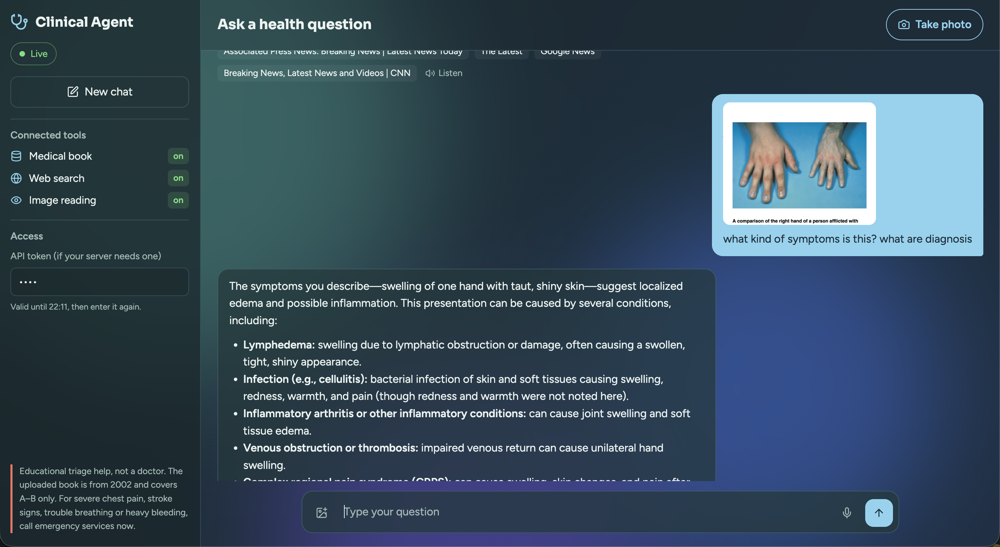
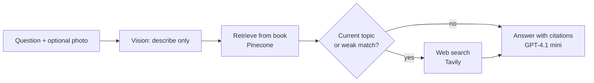

<div align="center">

# 🩺 Clinical Agent RAG

**A full-stack agentic medical AI assistant that reads a reference book, searches the web when the book isn't enough, looks at your photos, and talks back.**

<p>
  
</p>


</div>

> **It is not a doctor.** It explains carefully, says when it isn't sure, and tells you when to see a real clinician. It never gives a diagnosis, never prescribes, and for emergencies it tells you to call emergency services right away.

## See it working


| Chat interface | Photo upload | Answer with citations |
|:---:|:---:|:---:|
|  |  |  |

## What it does

- 📖 **Answers from a book.** The PDF is chunked and stored in Pinecone, so answers can point to a page like `[PDF p.42]`.
- 🌐 **Knows when the book is out of date.** The sample book is from 2002 and covers A to B only. For current topics or weak matches, it searches the web with Tavily.
- 📷 **Reads photos.** Upload an image or take one with your camera. It describes what is visible and never claims a diagnosis.
- 🎙️ **Speaks and listens.** Dictate your question and have any answer read aloud, with a stop button.
- 🧠 **Remembers the conversation** with LangGraph and SQLite.
- 🟢 **Shows what is available.** The sidebar switches the book, web search and image reading on or off based on your API keys.

## Tech stack

| Layer | Tools |
|---|---|
| Backend | Python, FastAPI, Uvicorn |
| Agent | LangGraph, LangChain OpenAI |
| AI models | OpenAI GPT-4.1 mini (chat and vision), text-embedding-3-small, Whisper, TTS |
| Search | Pinecone (book), Tavily (web) |
| PDF | PyMuPDF |
| Memory | SQLite checkpointer |
| Frontend | HTML, CSS, JavaScript, Lucide icons, Marked, DOMPurify |
| Tooling | uv |

<details>
<summary><b>How the agent decides (diagram)</b></summary>



</details>

## Project layout

```
Clinical-Agent-RAG/
├── app/
│   ├── agent.py        # LangGraph flow and safety prompt
│   ├── knowledge.py    # embeddings and Pinecone search
│   ├── config.py       # settings from .env
│   └── main.py         # FastAPI routes
├── static/             # style.css, app.js
├── templates/          # index.html
├── data/               # your PDF goes here
├── Screenshots/        # images used in this README
└── ingest.py           # loads the PDF into Pinecone
```

## Getting started

**1. Set up the project with [uv](https://docs.astral.sh/uv/)**

```bash
git clone https://github.com/Anushbharathwaj/Clinical-Agent-RAG.git
cd Clinical-Agent-RAG

uv venv
source .venv/bin/activate

uv add \
  "fastapi>=0.115,<1" \
  "uvicorn[standard]>=0.30,<1" \
  "python-multipart>=0.0.9" \
  "python-dotenv>=1,<2" \
  "pydantic-settings>=2,<3" \
  "langgraph>=0.3,<2" \
  "langchain-openai>=0.3,<2" \
  "pinecone>=6,<9" \
  "tavily-python>=0.5,<1" \
  "pymupdf>=1.24,<2" \
  "certifi>=2024" \
  "openai>=1.75,<3" \
  "httpx>=0.27,<1" \
  "langgraph-checkpoint-sqlite==3.1.2"
```

Starting from scratch instead? Run `uv init --app` first, then the commands above.

**2. Add your keys.** Create a `.env` file in the project root:

```env
OPENAI_API_KEY=sk-...
PINECONE_API_KEY=...
TAVILY_API_KEY=...        # optional, turns on web search
API_TOKEN=...             # optional, protects the API
```

**3. Load the book into Pinecone** (one time)

```bash
uv run python ingest.py --pdf data/Medical_book.pdf
```

**4. Start the app**

```bash
uvicorn app.main:app --reload --host 127.0.0.1 --port 8000
```

Open http://127.0.0.1:8000.

> **Testing the agent on its own?** Run it as a module from the root folder so the relative imports work: `python3 -m app.agent`

## Good to know

- Without a Tavily key the app still works, it just won't search the web.
- If you set `API_TOKEN`, paste it into the sidebar. It is kept in memory for one hour and cleared on refresh.
- Photos must be JPEG, PNG or WebP, under 5 MB.
- Microphone and camera need `localhost` or HTTPS in the browser.
- Keep `.env` and `Medical-DB.db` out of Git, and don't commit the book PDF.

## Ideas for later

- Support more than one book
- Stream answers as they are written
- Add a proper login

## License

Add a `LICENSE` file of your choice (MIT is a common one).
